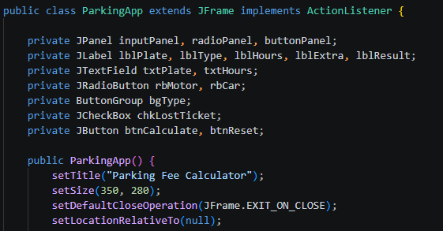
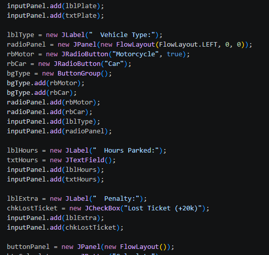
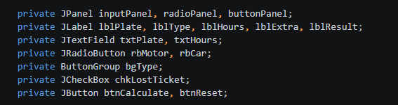
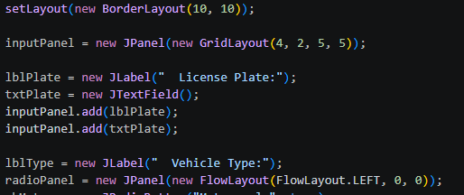
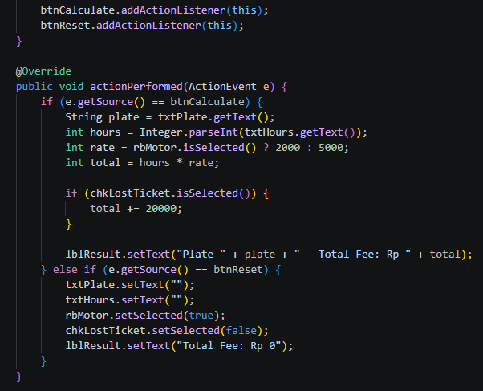
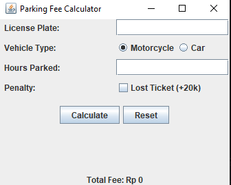
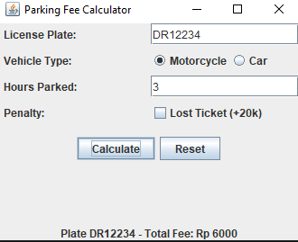

# Parking Fee Calculator

A simple Java Swing desktop application to calculate parking fees based on vehicle type, parking duration, and lost ticket penalty. Created for the Java GUI self-exploration exercise.


## Features

- Input license plate number and parking duration (in hours).
- Select vehicle type:
  - Motorcycle: Rp 2,000 / hour
  - Car: Rp 5,000 / hour
- Optional lost ticket penalty (+Rp 20,000).
- Calculate total fee and reset form inputs.

## 5 GUI Components Implemented

### 1. Top-Level Container

Uses `JFrame` as the main window of the application by extending it directly in the `ParkingApp` class.

```java
public class ParkingApp extends JFrame implements ActionListener {
    // ...
    public ParkingApp() {
        setTitle("Parking Fee Calculator");
        setSize(350, 280);
        setDefaultCloseOperation(JFrame.EXIT_ON_CLOSE);
        setLocationRelativeTo(null);
```



### 2. Intermediate Container

Uses three `JPanel` instances to group related components before placing them into the main frame:

- `inputPanel` – holds the form labels and input fields.
- `radioPanel` – groups the vehicle type radio buttons side by side.
- `buttonPanel` – holds the Calculate and Reset buttons.

```java
inputPanel = new JPanel(new GridLayout(4, 2, 5, 5));
radioPanel = new JPanel(new FlowLayout(FlowLayout.LEFT, 0, 0));
buttonPanel = new JPanel(new FlowLayout());

// Adding panels into the JFrame
add(inputPanel, BorderLayout.NORTH);
add(buttonPanel, BorderLayout.CENTER);
```



### 3. Atomic Components

Interactive and display components used inside the panels and frame:

- `JLabel` (`lblPlate`, `lblType`, `lblHours`, `lblExtra`, `lblResult`) for field labels and displaying the final fee.
- `JTextField` (`txtPlate`, `txtHours`) for user text input.
- `JRadioButton` (`rbMotor`, `rbCar`) paired with `ButtonGroup` (`bgType`) so only one vehicle type can be selected.
- `JCheckBox` (`chkLostTicket`) for the lost ticket penalty option.
- `JButton` (`btnCalculate`, `btnReset`) to trigger calculation and clear inputs.

```java
private JLabel lblPlate, lblType, lblHours, lblExtra, lblResult;
private JTextField txtPlate, txtHours;
private JRadioButton rbMotor, rbCar;
private ButtonGroup bgType;
private JCheckBox chkLostTicket;
private JButton btnCalculate, btnReset;
```



### 4. Layout Classes

Three layout managers are used to arrange the interface:

- `BorderLayout` on the main `JFrame` to divide the window into North (`inputPanel`), Center (`buttonPanel`), and South (`lblResult`).
- `GridLayout(4, 2, 5, 5)` on `inputPanel` to align the labels and inputs in a 4x2 grid.
- `FlowLayout` on `radioPanel` and `buttonPanel` to arrange the radio buttons and action buttons horizontally.

```java
setLayout(new BorderLayout(10, 10));

inputPanel = new JPanel(new GridLayout(4, 2, 5, 5));
radioPanel = new JPanel(new FlowLayout(FlowLayout.LEFT, 0, 0));
buttonPanel = new JPanel(new FlowLayout());
```



### 5. Event Listener

Implements the `ActionListener` interface and overrides `actionPerformed(ActionEvent e)` to handle clicks on `btnCalculate` and `btnReset`.

```java
btnCalculate.addActionListener(this);
btnReset.addActionListener(this);
```

```java
@Override
public void actionPerformed(ActionEvent e) {
    if (e.getSource() == btnCalculate) {
        String plate = txtPlate.getText();
        int hours = Integer.parseInt(txtHours.getText());
        int rate = rbMotor.isSelected() ? 2000 : 5000;
        int total = hours * rate;

        if (chkLostTicket.isSelected()) {
            total += 20000;
        }

        lblResult.setText("Plate " + plate + " - Total Fee: Rp " + total);
    } else if (e.getSource() == btnReset) {
        txtPlate.setText("");
        txtHours.setText("");
        rbMotor.setSelected(true);
        chkLostTicket.setSelected(false);
        lblResult.setText("Total Fee: Rp 0");
    }
}
```



## Screenshots

### Initial View



### After Calculation



## How to Run

Make sure the file name matches the public class name (`ParkingApp.java`), then compile and run via terminal:

```bash
javac ParkingApp.java
java ParkingApp
```